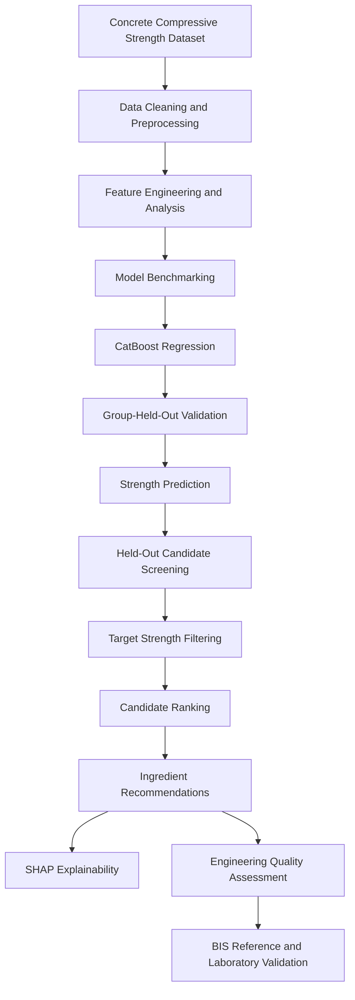

# BIS-Oriented Concrete Mix Recommendation & Quality Assessment System

\<p align="center">
&#x20; \<b>Machine Learning | Civil Engineering | Explainable AI\</b>
\</p>

\<p align="center">
&#x20; \
&#x20; \
&#x20; \
&#x20; \
&#x20; \
&#x20; \
\</p>

\<p align="center">
&#x20; \<a href="[https://github.com/usman-ahmad-123/BIS-Concrete-Mix-Recommendation-System](https://github.com/usman-ahmad-123/BIS-Concrete-Mix-Recommendation-System)">Repository\</a> ·
&#x20; \<a href="[https://doi.org/10.24432/C5PK67](https://doi.org/10.24432/C5PK67)">Dataset\</a> ·
&#x20; \<a href="[https://standards.bis.gov.in/](https://standards.bis.gov.in/)">BIS Standards\</a>
\</p>

---

## Overview

The **BIS-Oriented Concrete Mix Recommendation & Quality Assessment System** is an experimental machine-learning-based engineering decision-support application designed to explore concrete compressive-strength prediction and historical mix recommendation.

Developed using Python, CatBoost and Streamlit, the system combines predictive modelling, formulation-group-held-out validation and SHAP explainability to identify historically tested concrete mixtures that satisfy a user-defined target mean compressive strength.

Beyond strength prediction, the application incorporates engineering-oriented observations for fresh-concrete quality concerns, including bleeding, segregation, plastic shrinkage and workability loss.

The project aims to bridge **Civil Engineering and Artificial Intelligence** through data-driven analysis and explainable engineering decision support.

> **Scope:** This is a preliminary research prototype, not a certified BIS mix-design calculator. Candidate mixtures require material characterization, laboratory trials and approval by a qualified engineer.

## Key Features

- **Concrete Strength Prediction:** CatBoost regression using seven ingredient quantities and curing age.
- **Machine Learning Benchmarking:** Comparative evaluation of 11 baseline regression models.
- **Hyperparameter Optimization:** Optuna-based optimization of selected algorithms.
- **Robust Validation:** 80:20 formulation-group-held-out validation to reduce recipe-level data leakage.
- **Mix Recommendation:** Screening and ranking of historical formulations against a user-defined target mean strength.
- **Explainable AI:** SHAP-based interpretation of individual strength predictions.
- **Engineering Quality Assessment:** Qualitative review of bleeding, segregation, plastic shrinkage, workability retention and durability.
- **Interactive Application:** Streamlit-based interface for project requirements, candidate mixtures and engineering observations.

## System Workflow



## Dataset

**Source:** [UCI Machine Learning Repository — Concrete Compressive Strength](https://doi.org/10.24432/C5PK67)

The dataset contains 1,030 observations, eight input variables and one target variable.

| Input feature      | Unit  |
| ------------------ | ----- |
| Cement             | kg/m³ |
| Blast Furnace Slag | kg/m³ |
| Fly Ash            | kg/m³ |
| Water              | kg/m³ |
| Superplasticizer   | kg/m³ |
| Coarse Aggregate   | kg/m³ |
| Fine Aggregate     | kg/m³ |
| Curing Age         | Days  |

**Prediction target:** Concrete Compressive Strength (MPa).

Reference: Yeh, I.-C. (1998). *Modeling of strength of high-performance concrete using artificial neural networks*. Cement and Concrete Research, 28(12), 1797–1808.

## Machine Learning Methodology

### Original Benchmarking and Optimization

The initial modelling pipeline evaluated 11 regression algorithms using their default configurations. The five selected models were subsequently optimized using Optuna.

The original experimental workflow included:

- Exploratory Data Analysis and statistical profiling.
- Duplicate removal and data preprocessing.
- Water-cement ratio feature engineering.
- 80:20 train-test split with random state 2006.
- Feature standardization for applicable distance-based models.
- Optuna optimization using 70 trials per selected model.
- SHAP TreeExplainer for model interpretation.

**Original Benchmark results**

| Model             | Configuration |         R² | RMSE (MPa) | Reported Gap |
| ----------------- | ------------- | ---------: | ---------: | -----------: |
| CatBoost          | Baseline      | **0.9324** | **4.0119** |      0.00164 |
| Gradient Boosting | Tuned         |     0.9295 |     4.0976 |      0.00536 |
| XGBoost           | Tuned         |     0.9203 |     4.3578 |       0.0169 |
| LightGBM          | Baseline      |     0.9193 |     4.3853 |      0.00534 |
| Random Forest     | Tuned         |     0.8988 |     4.9114 |      0.00589 |

The original CatBoost baseline achieved the highest reported R² among the listed models.

These results belong to the original benchmarking experiment and should not be interpreted as the performance of the current recommendation application.

### Current Application Validation

The recommendation application uses a separate CatBoost training and evaluation workflow.

To reduce leakage between repeated curing-age observations of the same mixture formulation, it implements `GroupShuffleSplit`:

- **Training:** 80% of formulation groups.
- **Testing:** 20% of formulation groups.
- **Grouping:** Seven ingredient quantities, excluding curing age.
- **Random state:** 42.

The validation model is evaluated on unseen formulations using R², RMSE and MAE. Performance metrics are calculated dynamically rather than hard-coded.

A separate CatBoost model is trained on all cleaned observations and saved independently. The full-data model is not used to evaluate the held-out candidate recommendations.

### Candidate Recommendation

The user specifies:

- Target mean compressive strength.
- Optional characteristic concrete-grade reference.
- Curing age selected from historically observed ages.
- Construction purpose and exposure condition.
- Placement method and fresh-concrete requirements.

The application evaluates held-out historical formulations using the validation model.

Candidates satisfying the entered strength threshold are ranked by:

1. Lowest non-negative predicted strength surplus.
2. Lower total binder content as a tie-breaker.

The selected candidate is presented with ingredient quantities in kg/m³, predicted strength and water-to-binder ratio.

This is historical candidate screening, not global ingredient optimization or least-cost mix design.

## Engineering Quality Assessment

The application provides a qualitative engineering observation module for important concrete quality concerns.

| Concern           | Engineering considerations                               |
| ----------------- | -------------------------------------------------------- |
| Bleeding          | Water content, paste volume, fines and aggregate grading |
| Segregation       | Aggregate grading, cohesion, consistency and placement   |
| Plastic Shrinkage | Temperature, humidity, wind and curing conditions        |
| Workability Loss  | Slump retention and admixture compatibility              |
| Durability        | Exposure conditions, material properties and curing      |

Weather and placement information is collected for engineering review; it is not used as CatBoost input or converted into defect probabilities.

The source dataset contains no experimentally labelled defect outcomes. Consequently, the application does not claim to predict or eliminate bleeding, segregation, shrinkage or workability loss.

## BIS Engineering References

The project uses the following Indian Standards as engineering references:

| Standard                   | Subject                            |
| -------------------------- | ---------------------------------- |
| IS 10262:2019              | Concrete mix proportioning         |
| IS 456:2000                | Plain and reinforced concrete      |
| IS 383:2016                | Coarse and fine aggregates         |
| IS 9103:1999               | Concrete admixtures                |
| IS 1199 (Part 2):2018      | Fresh concrete consistency         |
| IS 1199 (Part 5):2018      | Making and curing test specimens   |
| IS 516 (Part 1/Sec 1):2021 | Hardened concrete strength testing |

**Additional information required for complete mix design:** Cement properties, aggregate grading, specific gravity, moisture content, water absorption, admixture characteristics, standard deviation, exposure classification and other project-specific design inputs.

The current application does not implement complete IS 10262 absolute-volume calculations, aggregate moisture corrections or automated BIS compliance verification. Applicable editions and amendments should be checked through the official [BIS Standards Portal](https://standards.bis.gov.in/).

## Technology Stack

| Category           | Technologies           |
| ------------------ | ---------------------- |
| Programming        | Python                 |
| Data Analysis      | Pandas, NumPy          |
| Machine Learning   | Scikit-learn, CatBoost |
| Model Optimization | Optuna                 |
| Explainable AI     | SHAP                   |
| Visualization      | Matplotlib             |
| Application        | Streamlit              |
| Model Persistence  | Joblib                 |

## Repository Structure

```text
BIS-Concrete-Mix-Recommendation-System/
│
├── app.py
├── requirements.txt
├── README.md
├── LICENSE
├── .gitignore
│
├── Codes/
│   ├── EDA.ipynb
│   ├── Preprocessing.ipynb
│   └── Modelling.ipynb
│
├── Datasets/
│   └── processed_datasets/
│
└── models/
    ├── baseline/
    └── tuned/
```

The application supports the dataset in `Datasets/Concrete_Data.csv`, `Datasets/Raw_data/Concrete_Data.csv`, `Raw_data/Concrete_Data.csv` and other configured locations.

Generated model artifacts are stored separately:

```text
models/tuned/
├── CatBoost_BIS_validation_group_holdout.pkl
├── CatBoost_BIS_full_data.pkl
└── CatBoost_BIS_model_metadata.json
```

## Installation and Usage

**Prerequisite:** Python 3.10 or later and the project dataset.

Install dependencies:

```bash
pip install -r requirements.txt
```

Run the application:

```bash
python -m streamlit run app.py
```

The application automatically cleans the dataset, trains and evaluates the models, and generates candidate recommendations.

## Research Report and References

**Dataset:** [UCI Concrete Compressive Strength](https://doi.org/10.24432/C5PK67)

**Technical documentation:**

- [CatBoost](https://catboost.ai/docs/)
- [Optuna](https://optuna.org/)
- [SHAP](https://shap.readthedocs.io/)
- [Streamlit](https://docs.streamlit.io/)
- [Scikit-learn](https://scikit-learn.org/stable/)

**BIS:** [Official Standards Portal](https://standards.bis.gov.in/)

## Limitations

The current implementation is an experimental decision-support prototype. It predicts compressive strength and screens historical candidate formulations; it does not independently design or certify a concrete mixture.

Final approval requires:

- Material characterization and aggregate grading.
- BIS-based mix proportioning and durability verification.
- Trial-batch workability, bleeding and segregation tests.
- Appropriate curing and compressive-strength testing.
- Review and approval by a qualified engineer.

## Author

**Md Usman Ahmad**
B.Tech, Civil and Environmental Engineering
Indian Institute of Technology Patna

**Areas of Interest:** Machine Learning, Data Science, Civil Engineering Analytics and AI-driven Engineering Systems.

[GitHub Profile](https://github.com/usman-ahmad-123) · [Project Repository](https://github.com/usman-ahmad-123/BIS-Concrete-Mix-Recommendation-System)

---

\<p align="center">
&#x20; \<b>Advancing Concrete Engineering Through Data-Driven Decision Support.\</b>
\</p>
