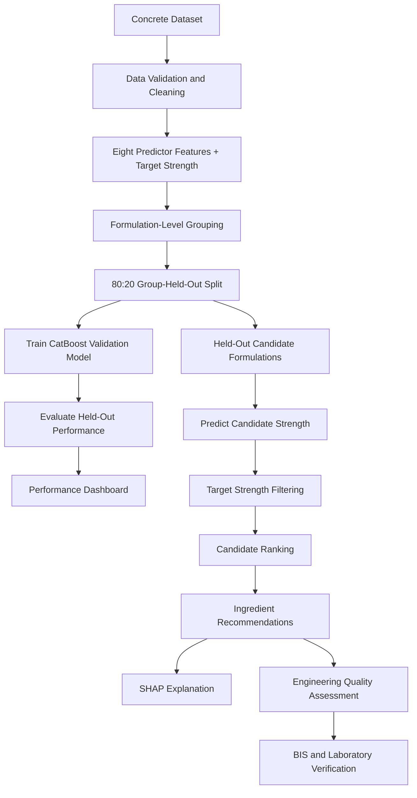

# BIS-Oriented Concrete Mix Recommendation & Quality Assessment System

<p align="center">
  <b>Machine Learning × Civil Engineering × Concrete Technology</b>
</p>

<p align="center">
  
  
  
  
  
  
  
</p>

<p align="center">
  <a href="https://github.com/usman-ahmad-123/BIS-Concrete-Mix-Recommendation-System">GitHub Repository</a>
  |
  <a href="https://archive.ics.uci.edu/dataset/165/concrete+compressive+strength">Dataset Source</a>
  |
  <a href="https://standards.bis.gov.in/">BIS Standards Portal</a>
</p>

---

## Overview

The **BIS-Oriented Concrete Mix Recommendation and Quality Assessment System** is a machine-learning-based engineering decision-support prototype developed to explore the relationship between concrete mixture composition, curing age and compressive strength.

The application combines CatBoost regression, formulation-group-held-out validation, SHAP explainability and an engineering observation module to identify historically tested concrete mixtures that meet a user-specified target mean compressive strength.

Users can specify project requirements, including construction purpose, exposure condition, placement method, testing age and fresh-concrete requirements. The system searches previously observed mixture formulations, evaluates their predicted strength and presents suitable candidate ingredient proportions.

The project is designed as a preliminary research and decision-support platform, with relevant Indian Standards serving as engineering references for subsequent material characterization, mix proportioning, laboratory trials and approval.

**Important:** This is not a certified BIS mix-design calculator. Its recommendations are historical candidate mixtures, not independently optimized or approved concrete mix proportions.

## Project Objectives

- Develop a machine-learning model to estimate concrete compressive strength from mixture composition and curing age.
- Implement formulation-level train-test separation to reduce data leakage from repeated curing-age observations of the same recipe.
- Generate candidate mixture recommendations for an independently entered target mean strength.
- Rank feasible candidates using predicted strength surplus and total binder content.
- Explain model predictions using SHAP.
- Provide an engineering observation framework for bleeding, segregation, plastic shrinkage, workability loss and durability concerns.
- Establish a foundation for integrating BIS-based mix proportioning and experimental validation.

## Key Features

| Component | Implementation |
|---|---|
| Concrete strength prediction | CatBoost Regression |
| Dataset processing | Missing-value, non-numeric, non-finite and basic physical-domain validation |
| Model validation | 80:20 GroupShuffleSplit by ingredient formulation |
| Performance evaluation | R², RMSE and MAE |
| Target strength input | Independent user-entered target mean strength |
| Candidate generation | Historically observed formulations from held-out groups |
| Candidate selection | Selected historically tested curing ages |
| Recommendation ranking | Minimum non-negative strength surplus, followed by total binder content |
| Explainable AI | SHAP local feature contributions |
| Quality assessment | Engineering observations and laboratory validation checklist |
| User interface | Streamlit |
| Model persistence | Separate validation and full-data models |

## System Architecture

The application follows a structured machine-learning and engineering-assessment workflow.



## Dataset and Input Variables

The project uses the **Concrete Compressive Strength dataset** from the UCI Machine Learning Repository, originally associated with the work of I-Cheng Yeh.

Dataset characteristics:

| Property | Description |
|---|---|
| Dataset | Concrete Compressive Strength |
| Source | UCI Machine Learning Repository |
| Observations | 1,030 |
| Input features | 8 |
| Output target | 1 |
| Machine-learning task | Regression |
| Target measurement | MPa |

### Independent Variables

The model uses eight input features.

| No. | Feature | Measurement |
|---:|---|---|
| 1 | Cement | kg/m³ |
| 2 | Blast Furnace Slag | kg/m³ |
| 3 | Fly Ash | kg/m³ |
| 4 | Water | kg/m³ |
| 5 | Superplasticizer | kg/m³ |
| 6 | Coarse Aggregate | kg/m³ |
| 7 | Fine Aggregate | kg/m³ |
| 8 | Curing Age | Days |

**Dependent Variable:** Concrete Compressive Strength (MPa).

The compressive-strength column is kept separate from the eight independent variables to prevent target leakage.

**Dataset source:** [UCI Machine Learning Repository — Concrete Compressive Strength](https://archive.ics.uci.edu/dataset/165/concrete+compressive+strength)

**Original research reference:**

Yeh, I.-C. (1998). Modeling of strength of high-performance concrete using artificial neural networks. *Cement and Concrete Research*, 28(12), 1797–1808.

## Methodology

### 1. Dataset Processing and Quality Control

The preprocessing pipeline performs the following operations:

- Identifies the eight expected predictor columns and the compressive-strength target.
- Normalizes column headers to handle whitespace variations.
- Converts input values into numerical formats.
- Identifies missing, non-numeric and non-finite observations.
- Applies basic physical-domain checks, including non-negative ingredient quantities and positive curing age.
- Removes invalid records instead of introducing fabricated ingredient or strength values.
- Reports dataset quality and the number of retained and removed observations.

The model uses the original measurement units rather than treating standardized ingredient quantities as physical mix proportions.

### 2. Formulation-Group-Held-Out Validation

A major consideration in concrete strength modelling is data leakage caused by repeated mixture formulations tested at different curing ages.

A conventional random row split can place observations from the same ingredient formulation in both training and testing datasets.

To address this, the application uses:

`GroupShuffleSplit`

The seven ingredient quantities define a formulation group. Curing age is excluded from the grouping variables so that observations of the same ingredient formulation at different ages remain in the same partition.

**Validation configuration:**

| Parameter | Configuration |
|---|---|
| Validation strategy | GroupShuffleSplit |
| Training proportion | 80% |
| Testing proportion | 20% |
| Grouping variables | Seven ingredient quantities |
| Random state | 42 |
| Regression algorithm | CatBoost |
| Iterations | 700 |
| Maximum tree depth | 6 |
| Learning rate | 0.05 |
| Loss function | RMSE |

### 3. Model Performance Evaluation

The validation model is evaluated only on unseen formulation groups.

Three evaluation metrics are calculated dynamically:

**Coefficient of Determination (R²)**

Measures the proportion of variance in the held-out target values explained by the regression model.

**Root Mean Squared Error (RMSE)**

Measures prediction error while penalizing larger errors more strongly.

**Mean Absolute Error (MAE)**

Measures the average absolute difference between predicted and actual compressive strength.

The application displays the actual evaluation results instead of using previously reported or manually hard-coded performance figures.

No performance value is assumed in advance.

*Note: These results represent one reproducible group-held-out split, not repeated group cross-validation or independent external validation.*

### 4. Candidate Mix Generation

Candidate formulations are selected from the held-out dataset groups.

The validation model predicts compressive strength for these previously unseen formulations at historically observed curing ages.

This is important because the candidate mixtures are not used to train the model that evaluates them.

The application does not randomly fabricate new ingredient quantities or assume that arbitrary ingredient combinations will produce valid concrete.

### 5. Target Mean Strength and Recommendation

The user independently specifies the target mean compressive strength in MPa.

An optional concrete-grade reference is provided separately. The application does not automatically calculate target mean strength from the selected grade.

Candidate mixtures are filtered using:

`Predicted Strength ≥ User-Entered Target Mean Strength`

The feasible candidates are ranked using:

1. Lowest non-negative predicted strength surplus.
2. Lower total binder content as a tie-breaker.

Total binder content is calculated as:

`Cement + Blast Furnace Slag + Fly Ash`

This ranking is a preliminary candidate-selection heuristic. It is not a globally optimal mix-design algorithm or least-cost optimization procedure.

### 6. Explainable Artificial Intelligence

SHAP (SHapley Additive exPlanations) is integrated to explain the selected candidate's predicted compressive strength.

The local feature-contribution plot identifies how individual input features influence the prediction relative to the model's expected output.

It helps interpret the contribution of:

- Cement
- Blast Furnace Slag
- Fly Ash
- Water
- Superplasticizer
- Coarse Aggregate
- Fine Aggregate
- Curing Age

SHAP explains model behaviour; it does not establish causal relationships or predict concrete defects.

## Engineering Quality Assessment

Concrete performance depends on more than compressive strength.

The application provides a separate engineering observation module covering important fresh-concrete and construction concerns.

| Engineering concern | Required assessment |
|---|---|
| Bleeding | Water content, paste volume, fines, grading and bleeding trials |
| Segregation | Aggregate grading, cohesion, consistency and placement trials |
| Plastic shrinkage | Temperature, humidity, wind, evaporation conditions and curing |
| Workability loss | Slump retention, transport duration and admixture compatibility |
| Durability | Exposure conditions, material properties, binder system and curing |

### Site and Construction Inputs

The interface records additional project conditions:

- Construction purpose.
- Exposure condition.
- Placement method.
- Required slump.
- Nominal maximum aggregate size.
- Transport and placement duration.
- Ambient temperature.
- Relative humidity.
- Wind speed.

These are contextual engineering inputs. They are not predictors in the trained CatBoost model and do not generate defect probabilities.

**Engineering limitation:** The source dataset contains no experimentally labelled bleeding, segregation, plastic-shrinkage or workability-retention measurements. Consequently, these concerns are addressed through qualitative engineering observations and laboratory-validation requirements, not fabricated machine-learning classifications.

## BIS Standards and Engineering References

The application identifies relevant Indian Standards as a starting point for project-specific engineering verification.

| Standard | Relevant subject |
|---|---|
| IS 10262:2019 | Concrete mix proportioning — guidelines |
| IS 456:2000 | Plain and reinforced concrete — code of practice |
| IS 383:2016 | Coarse and fine aggregate for concrete |
| IS 9103:1999 | Concrete admixtures |
| IS 1199 (Part 2):2018 | Fresh concrete consistency testing |
| IS 1199 (Part 5):2018 | Making and curing test specimens |
| IS 516 (Part 1/Sec 1):2021 | Hardened concrete strength testing |

Always consult the BIS catalogue for the current applicable editions, amendments, revisions and project requirements before using any standard in engineering practice.

Useful references:

- [BIS Standards Portal](https://standards.bis.gov.in/)
- [BIS — Know Your Standard](https://www.bis.gov.in/Know-Your-Standard/?lang=en)

### Information Required for a Complete Mix Design

The current dataset does not provide every input needed for a full BIS-based mix design.

Additional material and project information includes:

| Category | Required information |
|---|---|
| Cement | Type, grade, specific gravity and source |
| Fine aggregate | Grading zone, sieve analysis, specific gravity, absorption and moisture |
| Coarse aggregate | Grading, nominal size, specific gravity, absorption and moisture |
| Water | Quality and suitability |
| Fly ash and slag | Source, specific gravity, fineness and relevant conformity data |
| Chemical admixtures | Type, manufacturer dosage range and compatibility |
| Mix design | Standard deviation, exposure class, durability limits and water/binder requirements |
| Fresh concrete | Slump, density, air content, bleeding and segregation observations |
| Hardened concrete | Strength results and required durability tests |

The present application does not implement the complete IS 10262 absolute-volume proportioning calculation, aggregate moisture corrections, or automatic code-compliance verification.

## Model Storage and Reproducibility

The application saves the models and validation metadata separately.

```text
models/
└── tuned/
    ├── CatBoost_BIS_validation_group_holdout.pkl
    ├── CatBoost_BIS_full_data.pkl
    └── CatBoost_BIS_model_metadata.json
```

| Artifact | Purpose |
|---|---|
| Validation model | Trained only on the 80% training formulation groups; used for held-out performance evaluation and candidate scoring |
| Full-data model | Trained on all cleaned records and saved separately for subsequent deployment |
| Model metadata | Stores validation metrics, training/testing sizes and split information |

The original model file is not overwritten.

The validation model is retained separately to preserve the distinction between unseen-formulation evaluation and a model trained on the complete dataset.

## Technology Stack

| Area | Tools |
|---|---|
| Programming language | Python |
| Data manipulation | Pandas, NumPy |
| Machine learning | CatBoost |
| Model evaluation | Scikit-learn |
| Explainable AI | SHAP |
| Data visualization | Matplotlib |
| Interactive application | Streamlit |
| Model serialization | Joblib |
| Dataset formats | CSV, Excel |

## Project Structure

```text
BIS-Concrete-Mix-Recommendation-System/
│
├── app.py
│
├── requirements.txt
│
├── README.md
│
├── LICENSE
│
├── .gitignore
│
├── Codes/
│   ├── EDA.ipynb
│   ├── Modelling.ipynb
│   └── Preprocessing.ipynb
│
├── Datasets/
│   ├── processed_datasets/
│   └── Raw_data/
│       └── Concrete_Data.csv
│
└── models/
    └── tuned/
        ├── CatBoost_BIS_validation_group_holdout.pkl
        ├── CatBoost_BIS_full_data.pkl
        └── CatBoost_BIS_model_metadata.json
```

The generated model files are created when the application runs. The dataset directory shown above is an expected location; the application also supports several alternative dataset paths.

## Installation and Setup

### 1. Clone the repository

```bash
git clone https://github.com/usman-ahmad-123/BIS-Concrete-Mix-Recommendation-System.git
```

### 2. Navigate to the project directory

```bash
cd BIS-Concrete-Mix-Recommendation-System
```

### 3. Create a virtual environment

**Windows:**

```bash
python -m venv venv
venv\Scripts\activate
```

**Linux / macOS:**

```bash
python3 -m venv venv
source venv/bin/activate
```

### 4. Install dependencies

```bash
python -m pip install --upgrade pip
pip install -r requirements.txt
```

### 5. Verify package compatibility

```bash
python -m pip check
```

### 6. Prepare the dataset

Place `Concrete_Data.csv` in one of the supported locations:

```text
Raw_data/Concrete_Data.csv
Datasets/Raw_data/Concrete_Data.csv
Datasets/Concrete_Data.csv
Concrete_Data.csv
```

The application also supports `Raw_data/Concrete_Data.xlsx`.

The dataset should retain its original feature headers and the compressive-strength target column.

### 7. Run the Streamlit application

```bash
python -m streamlit run app.py
```

Open the local Streamlit URL displayed in your terminal.

On the first run, the application processes the dataset, trains and evaluates CatBoost models, and saves the resulting artifacts.

## Limitations and Scope

This project is an experimental academic and engineering decision-support prototype.

Its current capabilities should be distinguished from a complete engineering mix-design system.

| Capability | Current status |
|---|---|
| Compressive-strength regression | Implemented |
| Formulation-group-held-out validation | Implemented |
| Historical candidate recommendation | Implemented |
| Independent target mean strength input | Implemented |
| Strength-based candidate ranking | Implemented |
| SHAP explanation | Implemented |
| Fresh-concrete engineering observation module | Implemented as qualitative checks |
| Actual defect prediction | Not implemented |
| Global mixture optimization | Not implemented |
| Least-cost mix optimization | Not implemented |
| IS 10262 absolute-volume calculations | Not implemented |
| Aggregate moisture corrections | Not implemented |
| Automated BIS compliance certification | Not implemented |
| Laboratory verification | Required |

The dataset is limited to its historical concrete formulations and measured compressive strength observations. Its predictions should not be extrapolated beyond the supported data domain without additional validation.

A predicted strength above the requested threshold does not establish the workability, durability, stability, safety or code compliance of a concrete mixture.

**All candidate proportions must undergo appropriate material characterization, engineering review and laboratory trial batches before practical use.**

## Future Development Roadmap

The following enhancements are potential research and development directions:

- [ ] Implement complete IS 10262 mix-proportioning calculations.
- [ ] Integrate IS 456 exposure-class and durability constraints.
- [ ] Add aggregate sieve analysis and grading-based inputs.
- [ ] Incorporate specific gravity, absorption and moisture corrections.
- [ ] Add material-specific cement, fly-ash and slag properties.
- [ ] Integrate chemical admixture dosage and compatibility data.
- [ ] Develop constrained mix optimization with material-cost inputs.
- [ ] Collect laboratory data for bleeding and segregation assessment.
- [ ] Develop validated workability and slump-retention models.
- [ ] Integrate evaporation and plastic-shrinkage risk assessment.
- [ ] Implement uncertainty estimation and repeated group cross-validation.
- [ ] Validate recommendations using independent experimental mixtures.

## Author

**Md Usman Ahmad**

B.Tech — Civil and Environmental Engineering  
Indian Institute of Technology Patna

**Technical Interests:** Machine Learning, Data Science, Civil Engineering Analytics, Artificial Intelligence and Engineering Decision Support.

- GitHub: [@usman-ahmad-123](https://github.com/usman-ahmad-123)
- Project Repository: [BIS Concrete Mix Recommendation System](https://github.com/usman-ahmad-123/BIS-Concrete-Mix-Recommendation-System)

## References

1. Yeh, I.-C. (1998). *Modeling of strength of high-performance concrete using artificial neural networks*. Cement and Concrete Research, 28(12), 1797–1808.
2. [UCI Machine Learning Repository — Concrete Compressive Strength](https://archive.ics.uci.edu/dataset/165/concrete+compressive+strength).
3. [Bureau of Indian Standards — Official Standards Portal](https://standards.bis.gov.in/).
4. [BIS — Know Your Standard](https://www.bis.gov.in/Know-Your-Standard/?lang=en).
5. [CatBoost Documentation](https://catboost.ai/docs/).
6. [SHAP Documentation](https://shap.readthedocs.io/).
7. [Streamlit Documentation](https://docs.streamlit.io/).
8. [Scikit-learn Documentation](https://scikit-learn.org/stable/).

## License

This project is released under the MIT License, as indicated by the repository's LICENSE file.

The dataset and third-party materials remain subject to their respective original terms and attribution requirements.

---

<p align="center">
  <b>Advancing Concrete Engineering Through Data-Driven Decision Support.</b>
</p>

<p align="center">
  <sub>Built with Python, Machine Learning and Civil Engineering principles.</sub>
</p>
